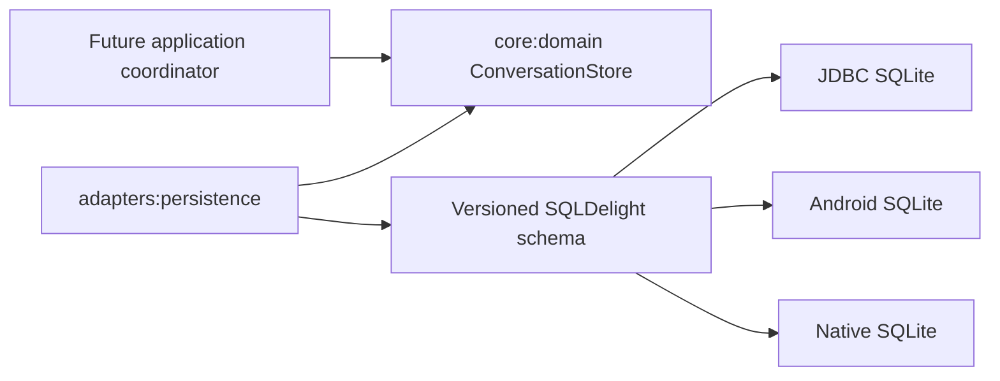

# Conversation persistence

Blowhard isolates durable local state behind `ConversationStore`. The core owns the records and
behavioral contract; the SQLDelight adapter owns SQL, migrations, driver selection, and mapping.
Presentation code has no database dependency.

## Current contract

The first storage increment persists conversation identity, title, creation time, and most recent
update time. Saves are serialized and transactional. Updating a conversation preserves its
original creation time. Lists are ordered by update time and then identity, so equal timestamps do
not produce unstable presentation order. Closing the store is idempotent; later operations fail
instead of using a released driver.

The desktop contract tests create a real temporary database, close it, reopen it through the public
factory, and verify Unicode content, ordering, updates, and deletion. Android device and iOS runtime
storage tests still require their platform hosts, but both driver paths compile in CI.

## Schema evolution

The current schema is version 1. Its generated SQLite baseline is committed next to the SQL source.
SQLDelight compares that baseline with the latest create statements in `verifySqlDelightMigration`.
Future changes must include numbered migration files and tests that open representative old schema
fixtures before the baseline is regenerated.

The schema deliberately targets SQLite 3.18. Android API 26 guarantees an older SQLite engine than
the modern UPSERT syntax requires, so save uses `INSERT OR IGNORE` plus `UPDATE` inside one
transaction. This keeps the minimum Android target truthful without maintaining divergent SQL.

## Data and security boundary

The database is intended for app-owned local storage. It must never contain provider credentials;
those remain in the platform credential vault. The database is not application-encrypted and does
not protect content from the same OS user, local malware, backups, or a compromised operating
system. Platform file permissions and full deletion behavior must be verified before persistent
history is enabled in the application.

## Deliberate limitations

- Messages, attempts, configuration snapshots, and terminal outcomes are not persisted yet.
- The desktop composition root does not open this store yet, so visible conversations remain
  process-local.
- In-flight recovery and retention behavior are not implemented.
- No claim is made that closing SQLite securely erases previously stored bytes.

These limits keep schema compatibility independently reviewable before lifecycle code begins to
depend on it.
