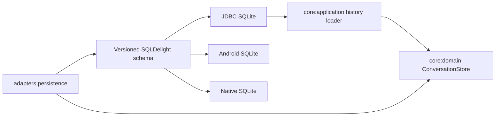

# Conversation persistence

Blowhard isolates durable local state behind `ConversationStore`. The core owns the records and
behavioral contract; the SQLDelight adapter owns SQL, migrations, driver selection, and mapping.
Presentation code has no database dependency.

## Current contract

The store persists conversation identity, title, creation time, and most recent update time.
Metadata saves are serialized and transactional. Updating a conversation preserves its original
creation time. Lists are ordered by update time and then identity, so equal timestamps do not
produce unstable presentation order.

A `StoredTranscript` is one validated aggregate containing ordered messages and generation
attempts. Attempts reference distinct user and assistant messages and preserve:

- run identity;
- demo or live source and the exact live model identifier;
- maximum-output and temperature snapshots;
- queued, running, succeeded, failed, cancelled, or interrupted state;
- safely classified failure and retry metadata;
- creation and latest-update timestamps.

Replacing a transcript deletes and reinserts its child rows inside one SQLite transaction. A
constraint failure restores the previous transcript. Conversation deletion removes attempts,
messages, and metadata explicitly inside one transaction, in dependency order. Foreign keys encode
the same ownership in the schema as a defensive layer, but deletion correctness does not depend on
driver-specific foreign-key defaults. Closing the store is idempotent, and later operations fail
instead of using a released driver.

The desktop contract tests create real temporary databases and verify close/reopen behavior,
Unicode content, deterministic ordering, immutable routing/configuration snapshots, classified
failures, transaction rollback, and complete owned-row deletion. Android device and iOS runtime
storage tests still require their platform hosts, but both driver paths compile in CI.

## Restart recovery

`recoverInFlightAttempts` is an explicit fail-closed recovery operation. In one database update it
changes every queued or running attempt to interrupted and returns the number of changed rows.
Messages, partial assistant output, provider/model selection, generation controls, and terminal
attempts remain unchanged. The transition timestamp is the later of the stored update time and the
recovery time, so a backward system-clock adjustment cannot violate chronology.

The operation is idempotent and has no generation-port dependency, so it cannot replay provider
work. A startup coordinator must call it after opening storage and before exposing recovered
history. `ConversationHistoryLoader` enforces recovery before list/load operations, while the
desktop composition root owns the database session and maps domain records into presentation
models.

The most recently updated stored conversation is selected deterministically. Interrupted partial
responses are visible and labeled, while defensive mapping treats any unexpectedly active durable
state as interrupted rather than presenting a phantom cancellable run. An empty database creates a
clean demo workspace. A storage open or load failure creates an explicit, content-safe unavailable
state; it does not expose paths/driver details or silently replace durable storage with an
in-memory repository.

## Schema evolution

The current schema is version 2. The committed version-1 SQLite baseline remains unchanged, and
`1.sqm` adds message and attempt tables plus their indexes and constraints. SQLDelight applies the
migration to that baseline and compares the result with the latest create statements in
`verifySqlDelightMigration`. A separate runtime test copies the same fixture, inserts legacy
metadata, opens it through the public desktop factory, and verifies the metadata survives.

Future schema changes must include the next numbered migration and a runtime test that opens the
representative old fixture. Existing baselines must not be silently regenerated to match new SQL.

The schema deliberately targets SQLite 3.18. Android API 26 guarantees an older SQLite engine than
the modern UPSERT syntax requires, so save uses `INSERT OR IGNORE` plus `UPDATE` inside one
transaction. This keeps the minimum Android target truthful without maintaining divergent SQL.

## Data and security boundary

The database is intended for app-owned local storage. It must never contain provider credentials;
those remain in the platform credential vault. The database is not application-encrypted and does
not protect content from the same OS user, local malware, backups, or a compromised operating
system. Platform file permissions and full deletion behavior must be verified before persistent
history is enabled in the application.

The desktop database path follows platform application-configuration conventions:

- macOS: `~/Library/Application Support/Blowhard/conversations.db`;
- Windows: `%APPDATA%/Blowhard/conversations.db`, with the documented home-directory fallback;
- Linux: `$XDG_CONFIG_HOME/blowhard/conversations.db`, or `~/.config/blowhard/conversations.db`.

The database is opened during desktop startup and closed exactly once during runtime shutdown.

## Deliberate limitations

- New messages and attempts remain process-local because checkpoint writes are not wired yet.
- Full retention and user-facing deletion behavior are not wired to presentation actions.
- No claim is made that closing SQLite securely erases previously stored bytes.

These limits keep startup recovery independently reviewable before live checkpoint scheduling and
write-failure behavior are introduced.
