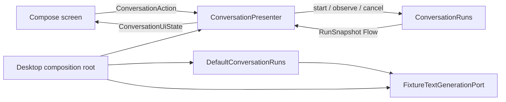

# Conversation presentation

The shared UI is a consumer of the public run contract. It never calls a provider adapter and never
collects generation work directly.

`ConversationPresenter` owns a serialized event loop. A successful Send records the user message,
creates one pending assistant message, and passively observes the accepted run. Streaming snapshots
replace that assistant message's text; terminal snapshots make its delivery state immutable.
Duplicate Send actions are ignored while the selected conversation is starting, queued, or
streaming.

## Explicit regeneration

Every accepted run labels its user and assistant messages with the same opaque attempt identity.
Regenerate resolves the prompt paired with the selected terminal response and asks
`ConversationRuns` to start a new run. It appends another pair with a new identity; the original
prompt, output, delivery state, and demo/live target remain unchanged.

The new attempt captures the mode and verified model selected when it is accepted. The control says
"Regenerate with current mode" to make that boundary visible. A start rejection preserves both
history and any unrelated composer draft.

Regeneration is never automatic. Successful and cancelled attempts allow it. Failed attempts allow
it only when the core reports `EXPLICIT_NEW_ATTEMPT`; delay-required and unsafe failures keep the
control unavailable.

Switching conversations never changes execution ownership. Several conversations may run within
the application's concurrency policy, while each conversation still has at most one active run.

## Offline demonstration

The desktop composition root offers four bundled scenarios:

| Scenario | Demonstrates |
| --- | --- |
| Success | Incremental Markdown-shaped output and completion |
| Failure | Partial output followed by a typed failure |
| Rate limited | A client-safe rate-limit message |
| Interrupted | Redaction of an unexpected stream interruption |

The scenario router is keyed by conversation and consumes a selection once. The fixture still runs
through `DefaultConversationRuns`; the screen has no fixture-specific execution path.

## Safe output rendering

Provider text is parsed into a deliberately small render model: headings, paragraphs, bullets, and
fenced code. Unsupported Markdown, raw HTML, and link syntax are displayed as inert text. This
keeps the demonstration selectable and readable without granting generated content navigation or
execution capabilities.
