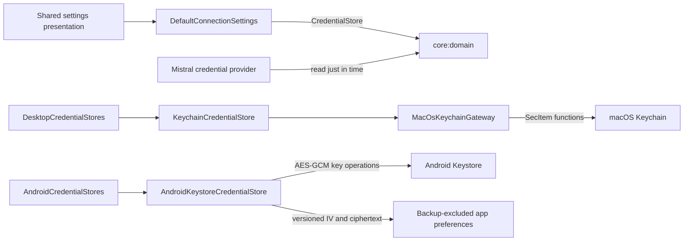

# Credential storage boundary

The credential store is owned by the application boundary rather than the Mistral adapter:



`CredentialStore` exposes only typed read, replace, and delete outcomes. It does not expose native
status codes or a platform storage path. `CredentialReadResult.Available` deliberately redacts its
`toString()` representation, and callers must consume its value promptly without logging it.

On macOS, the adapter stores one generic-password item under service
`io.github.artemidius.blowhard` and account `mistral-api-key`. It updates before adding so replacing a
key does not leave abandoned entries. Delete treats an absent item as success.

Windows and Linux currently return `PLATFORM_UNAVAILABLE`. This is intentional fail-closed behavior:
there is no plaintext preferences, database, environment, or file fallback.

Android uses a non-exportable 256-bit AES key generated by Android Keystore. The credential is encrypted
with randomized GCM plus application-specific authenticated data; only a versioned IV and ciphertext record
enters app-private preferences. Cloud backup and device transfer exclude that file. Corrupt records, missing
keys, and cryptographic failures return sanitized unavailable results without deleting or replacing data during
a read. See [ADR 0035](../decisions/0035-android-keystore-credential-envelope.md).

The desktop settings screen keeps typed credential text only in transient, non-saveable UI state.
Submission clears the field and sends the value directly through `ConnectionSettings` to this
store. Presenter state and notices never contain credential material.

## Verification

The normal test suite uses an injected native gateway and covers missing, denied, locked,
unexpected, replacement-race, validation, cleanup, and deletion behavior without touching a user's
Keychain. On macOS, run the isolated lifecycle check explicitly:

```shell
BLOWHARD_KEYCHAIN_INTEGRATION=1 ./gradlew \
  :adapters:platform:test --tests '*MacOsKeychainIntegrationTest*' --rerun-tasks
```

The test uses a synthetic, process-specific account in a test-only service and removes it in a
`finally` block. It never accesses the application's Mistral credential.

The Android adapter has both deterministic host tests and an instrumented lifecycle test using a
process-isolated preference file and Keystore alias:

```shell
./gradlew :adapters:mobile-platform:connectedAndroidDeviceTest
```
