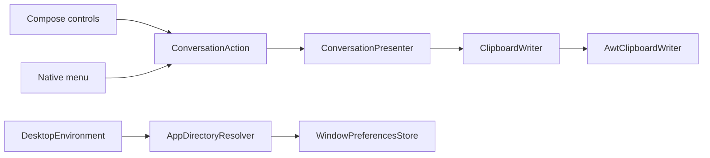

# Desktop platform support

The desktop shell keeps operating-system services at the application boundary. Compose controls and
native menu items both dispatch the shared conversation actions, while clipboard and filesystem
details remain desktop adapters.

## Current support evidence

| Platform | Package | Automated CI evidence | Interactive evidence |
| --- | --- | --- | --- |
| macOS 15, Apple silicon | `.dmg` | Build, inspect, install, launch, and complete an internal fixture scenario | Current development host completed a bounded live check; layout, focus, menus, and clipboard are checked manually |
| Windows Server 2025 runner, x64 | `.msi` | Build, inspect, install, launch, and complete an internal fixture scenario | No interactive or live claim |
| Ubuntu 24.04 runner, amd64 | `.deb` | Build, inspect, install under Xvfb, launch, and complete an internal fixture scenario | No interactive or live claim |

The internal fixture exercises the package lifecycle; it is not a user-selectable demo mode. The
macOS [live reference check](../live-reference-check.md) uses the real provider but does not itself
prove that a release installer is signed or distributed.

The Linux clipboard adapter requires a non-headless AWT session with `DISPLAY`. CI supplies that
session with Xvfb. A Wayland-only session without X11 compatibility is not currently covered.

## Desktop boundaries

Platform directory resolution follows native conventions:

| Platform | Configuration | Cache |
| --- | --- | --- |
| macOS | `~/Library/Application Support/Blowhard` | `~/Library/Caches/Blowhard` |
| Windows | `%APPDATA%/Blowhard` with a user-home fallback | `%LOCALAPPDATA%/Blowhard/Cache` with a user-home fallback |
| Linux | `$XDG_CONFIG_HOME/blowhard` or `~/.config/blowhard` | `$XDG_CACHE_HOME/blowhard` or `~/.cache/blowhard` |

Only window dimensions and maximized state are persisted. Values are bounded before writing, and
missing, malformed, or unreadable files use defaults. Clipboard failures produce generic UI feedback
and do not expose native exception details.

## Keyboard interaction

| Action | macOS | Windows and Linux |
| --- | --- | --- |
| Send | `Command+Enter` | `Ctrl+Enter` |
| Stop | `Escape` | `Escape` |
| New conversation | `Command+N` | `Ctrl+N` |
| Copy latest response | `Shift+Command+C` | `Shift+Ctrl+C` |
| Exit | `Command+Q` | `Ctrl+Q` |

Each non-empty message also exposes a visible copy control. Focus returns to the composer after a run
finishes or the selected conversation changes, and changing window width switches between compact
and wide navigation without changing the shared state contract.
