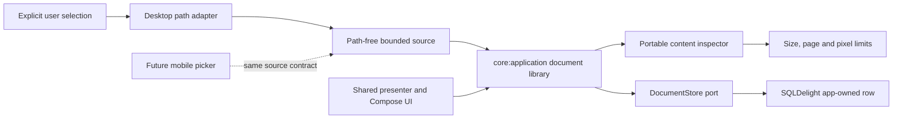

# Local document lifecycle

Blowhard treats document selection, inspection, ownership, presentation, and any future provider
use as distinct boundaries. The current lifecycle is entirely local: importing a document never
starts generation and never sends bytes to Mistral.

## Contract and dependency direction

`core:api` defines opaque document identities, immutable verified metadata, path-free import
sources, and typed lifecycle results. `core:domain` owns the inspection and storage ports.
`core:application` reads a selected source once, asks the inspector for verified characteristics,
applies policy, creates an identity and timestamp, then saves through the store.

`adapters:documents` implements the byte-level inspector in common Kotlin. `adapters:persistence`
maps metadata and copied bytes to one SQLDelight row and supplies desktop, Android, and Native
driver factories. `shared-ui` serializes picker, refresh, import, confirmation, and deletion actions
without knowing a native path or database type. The desktop composition root provides the AWT
picker and owns both the database session and presenter lifecycle.

## Import transaction

The native picker returns a desktop-only `DocumentImportSource`. Its public metadata is limited to
a filename and optional size. Reading happens on an I/O dispatcher, does not follow symbolic links,
checks cancellation between chunks, and stops as soon as content exceeds the configured maximum.
The resulting byte array is defensively copied at the API and persistence boundaries.

The portable inspector does not trust an extension:

- PNG requires the signature, one valid IHDR, bounded chunks, verified CRC values, image data, and
  a terminal IEND;
- JPEG requires a valid marker walk, supported frame dimensions, a scan header, bounded entropy
  data, and an end marker;
- PDF requires a supported header, terminal marker, and explicit page objects, while encrypted
  files and object streams fail closed.

Accepted content is limited to 20 MiB, 100 PDF pages, and 40 million image pixels. The SQLDelight
store saves identity, display metadata, verified format characteristics, and BLOB content in one
row. Constraints repeat important invariants at the storage boundary. A collision or failed write
does not publish a successful import.

## Presentation and restart behavior

One shared presenter processes actions sequentially so an import cannot race a refresh or confirmed
deletion. UI state contains immutable document metadata, a busy flag, one pending confirmation,
and typed notices. Unexpected picker, storage, or mapping failures become a generic unavailable
notice; native paths and exception messages do not enter observable state.

The desktop opens document storage in the same app-owned database used by conversation history but
through an independently owned store. A real composition test imports a synthetic PDF, closes the
session, reopens it, verifies the original identity and timestamp, deletes it, and confirms another
reopen is empty. Closing sessions and presenters is idempotent. If storage cannot open, the rest of
the application still starts and the document library returns only unavailable outcomes.

## Ownership, retention, and deletion

The selected original remains owned by the user and is never changed. Blowhard owns only its copied
database row. Imported documents remain until individually deleted; there is no automatic expiry or
background upload. Confirmation names the local document and states that the original is unaffected.
Metadata and copied content are removed together.

The database is not application-encrypted. It does not protect content from the same OS user,
malware, backups, filesystem snapshots, or a compromised operating system. SQLite deletion is not
secure erasure. Future provider attachments must add a separate, explicit disclosure and request
boundary; local import alone is not consent to external processing.

## Deliberate limitations

- The current parser verifies a conservative structural subset; it does not render, extract text,
  decompress pixels, execute PDF content, or resolve external resources.
- Valid PDFs using encryption, object streams, or page structures outside the explicit subset are
  rejected.
- Documents cannot yet be attached to a conversation, indexed, searched, or sent to a provider.
- Desktop has a picker implementation; mobile clients can reuse the lifecycle after supplying their
  own platform picker and storage composition.

These constraints keep the implemented security and privacy claims aligned with tested behavior.
