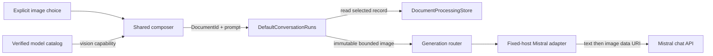

# Explicit image questions

Image questions extend the same application-owned conversation lifecycle without making Compose,
the core API, or persistence depend on Mistral transport types.

## Trust boundaries

The document library owns copied bytes and verified content metadata. Conversation presentation
receives only imported-document metadata; it never receives native paths or image bytes. Selection
adds one opaque `DocumentId` to the next start request and records only a bounded display name on
the visible user message.

`DefaultConversationRuns` is the enforcement point. It requires the captured model snapshot to
advertise vision support before reading storage, resolves only an app-owned imported record, and
accepts only verified PNG or JPEG content within the 20 MiB image limit. Any failure becomes a
typed start rejection before generation is invoked.

The generation request defensively copies image bytes. The Mistral adapter constructs a base64 data
URI in memory and sends it through the existing fixed-host, credential-isolated chat client. It
does not accept a file URL, native path, or provider-fetched remote URL. The message parts are
ordered deliberately: user text first, selected image second.

## Consent and lifecycle

- Import is local and never implies upload.
- Attachment requires an explicit choice in the conversation composer.
- The composer exposes images only for a model with explicit provider-reported vision capability.
- A successful start consumes the selection; a rejected start restores it for correction.
- Changing model settings after acceptance cannot alter the captured attempt.
- Stop and cancellation use the existing run lifecycle; no POST is replayed automatically.
- Regeneration is text-only unless the user explicitly attaches an image again.

The provider contract follows Mistral's documented
[vision message format](https://docs.mistral.ai/inference/conversations/vision) and
[chat endpoint](https://docs.mistral.ai/api/endpoint/chat). Provider documentation currently lists
a 20 MiB maximum image size; Blowhard repeats that bound at its local API and storage boundaries.

## Verification

Core tests prove capability gating happens before document reads, missing and unsupported records
do not invoke generation, and mutable source arrays cannot alter accepted requests. Adapter tests
assert exact content ordering and data-URI encoding while preserving the text-only JSON shape.
Presentation tests prove one-time attachment, safe display metadata, rejection restoration, and
the absence of encoded bytes from observable state.
