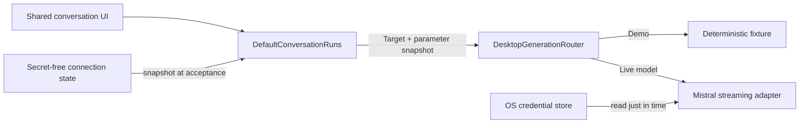

# Live conversation routing

Demo and live generation share the same application-owned run lifecycle. The selected source is
captured when a run is accepted, before it can wait for an execution permit.

## Attempt invariants

- `Demo` never creates a provider client or reads a provider credential.
- `Live(modelId)` is accepted only when credential status, connection verification, compatible
  model selection, and external-processing acknowledgement are all current.
- The model identifier is validated and stored without credential material.
- A mode, model, or generation-control change after acceptance affects only later attempts.
- Maximum output tokens and temperature are immutable typed values on the internal generation
  request. Null values preserve model defaults rather than inventing client-side defaults.
- A live construction, authentication, rate-limit, transport, or stream failure remains on the
  live path. There is no fixture fallback and no automatic POST replay.

The start result exposes the captured target so shared presentation can label the conversation and
both messages without reading provider configuration independently. The provider adapter continues
to reduce failures to sanitized core categories.

## Desktop ownership

The desktop composition root creates the deterministic adapter, the Mistral credential bridge, and
the target router. Live adapters are cached by verified model identifier and closed after the run
service has cancelled and joined active work. The Mistral adapter reads the Keychain-backed
credential for each request rather than retaining it in the router.

macOS is the current verified secure-storage host. Windows and Linux cannot satisfy live readiness,
so the desktop conversation remains inactive; no preferences or file fallback is used.

## Verification boundary

Automated tests use synthetic ports and HTTP fixtures. They verify immutable target capture, stale
configuration rejection, exact routing, no fallback, sanitized construction failure, adapter reuse,
parameter snapshotting, and lifecycle closure without requiring a real credential or network
request.

A real-provider smoke check is deliberately manual and bounded: select one verified chat model,
send one short non-sensitive prompt, cancel if no first event arrives within 30 seconds, and record
only model identifier, terminal status, elapsed time, and provider-reported usage when available.
Never record the API key, prompt, response, native vault output, or provider error body. No live
smoke result is claimed until that procedure has actually been completed.
