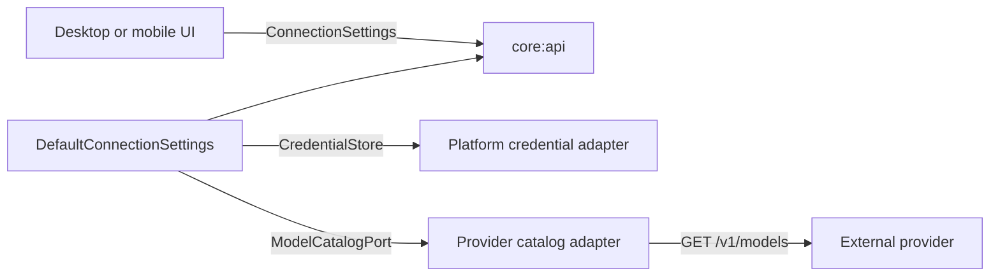

# Live-provider settings

The settings workflow is a shared application service. Presentation code observes a secret-free
state and sends intent through a provider-neutral API; platform and provider details remain behind
domain ports.

## State progression

1. Refresh credential status. The shared state reports only `MISSING`, `CONFIGURED`, or
   `UNAVAILABLE`; it never contains the secret.
2. Run an explicit connection test. This uses model discovery rather than a generative request, so
   verifying configuration does not consume a prompt or create model output.
3. Filter conservatively. Only models reported as `AVAILABLE` with chat completion reported as
   `SUPPORTED` become selectable. `UNKNOWN` never enables a capability.
4. Select a verified model and acknowledge that live prompts are processed externally.
5. Select live mode. All prerequisites are checked atomically by the application service.

Credential replacement and deletion clear the connection result, model list, selected model, and
disclosure acknowledgement. A provider failure during a later check changes the connection status
to `FAILED` but preserves the explicit generation-mode choice; downstream routing must require a
currently ready state rather than inferring an automatic fallback.

## Failure and concurrency policy

Settings operations are serialized. This prevents a slow catalog response from overwriting a
credential mutation or a newer model choice. Cancellation is propagated and restores the state
that preceded the test.

Catalog failures are reduced to categories suitable for presentation, such as unauthorized,
rate-limited, provider unavailable, or invalid response. Error response bodies and exception
messages remain inside the adapter boundary. The application additionally reports
`NO_COMPATIBLE_MODELS` when a valid catalog contains no model with explicit availability and chat
support.

See [`ADR 0012`](../decisions/0012-explicit-live-provider-settings.md) for the decision record and
the [Mistral provider boundary](mistral-provider-boundary.md) for transport hardening.
