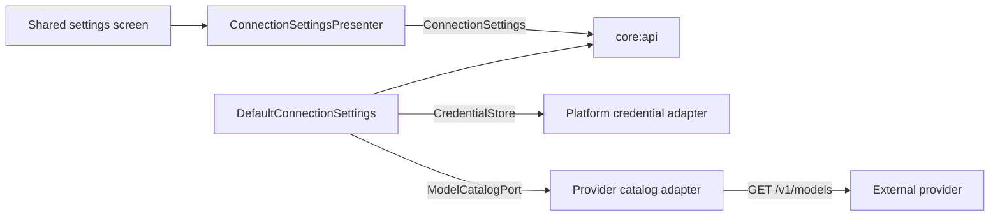

# Live-provider settings

The settings workflow is a shared application service. Presentation code observes a secret-free
state and sends intent through a provider-neutral API; platform and provider details remain behind
domain ports.

## State progression

1. Refresh credential status. The shared state reports only `MISSING`, `CONFIGURED`, or
   `UNAVAILABLE`; it never contains the secret.
2. On desktop, automatically run a connection test when a configured credential is found at startup
   or a new credential is saved. The user can retry the check in settings. Verification uses model
   discovery rather than a generative request, so it does not consume a prompt or create model output.
3. Filter conservatively. Models explicitly marked archived are excluded. Base model cards without
   an `archived` field are available through the account catalog; chat completion must still be
   explicitly reported as supported. `UNKNOWN` never enables a capability.
4. Select a verified model. The desktop entry screen discloses that messages are processed by
   Mistral before the user saves a key or sends a message.
5. Choose bounded maximum-output and temperature presets, or retain explicit model defaults.
6. Open the conversation when the credential, connection, and model are ready. Normal desktop
   launches remain on the connection screen until these prerequisites are satisfied.

The desktop screen implements all six steps. Changing the model or generation controls affects new
attempts only; an already accepted attempt keeps its captured source, model, and
parameter snapshot.

## Presentation security

The presenter observes the provider-neutral state and publishes only that snapshot plus fixed,
sanitized feedback. API-key input uses ordinary Compose state rather than saveable state. Submission
clears the visible field and passes a redacted internal action to the presenter; credential text is
never copied into the presenter's `StateFlow`.

The desktop composition root owns the macOS Keychain store and Mistral model catalog. The catalog
reads the credential just in time through a small adapter and does not cache it. Windows and Linux
surface `UNAVAILABLE` because their verified OS vault adapters are not implemented; no file or
preferences fallback is present.

Credential replacement and deletion clear the connection result, model list, and selected model.
Non-sensitive generation controls remain available. A provider failure during a later check changes
the connection status to `FAILED` and clears the stale model list. The conversation stays inactive
until verification succeeds again.

Conversation routing performs that readiness check when accepting every live start. A stale live
selection is rejected before provider execution and is never replaced with fixture generation. See
the [live conversation routing guide](live-conversation-routing.md).

## Failure and concurrency policy

Settings operations are serialized. This prevents a slow catalog response from overwriting a
credential mutation or a newer model choice. Cancellation is propagated and restores the state
that preceded the test.

Catalog failures are reduced to categories suitable for presentation, such as unauthorized,
rate-limited, provider unavailable, or invalid response. Error response bodies and exception
messages remain inside the adapter boundary. The application additionally reports
`NO_COMPATIBLE_MODELS` when a valid catalog contains no model with explicit availability and chat
support.

See [`ADR 0012`](../decisions/0012-explicit-live-provider-settings.md) for the application policy,
[`ADR 0013`](../decisions/0013-provider-settings-presentation.md) for presentation and composition,
[`ADR 0016`](../decisions/0016-generation-parameter-snapshots.md) for parameter snapshots,
and the [Mistral provider boundary](mistral-provider-boundary.md) for transport hardening.
