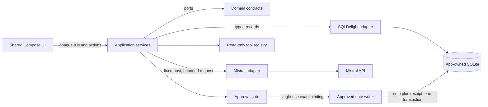

# Meeting-note showcase architecture

The showcase is intentionally one narrow, inspectable vertical slice. It combines local document handling,
structured AI output, evidence, editable typed state, bounded tool execution, explicit consent, and crash-safe
persistence without collapsing those concerns into the UI.

## Trust boundaries

| Boundary | Control |
| --- | --- |
| Native file system to local document store | Explicit picker, content inspection, byte/page/pixel caps, opaque IDs, atomic copy |
| Local document to provider | Separate user action, fixed HTTPS host, one selected source, bounded payload and response |
| Provider output to application state | Strict structured parser, field caps, source-reference validation, no executable content |
| Model tool proposal to local read | Fixed registry, strict JSON schemas, attached-document scope, bounded result sizes |
| Proposed mutation to local write | Exact content and destination preview, explicit approval, expiry, single-use consent |
| Process interruption to recovery | Deterministic operation ID and transactional receipt; recovery observes and never replays |

Provider text and imported document text are untrusted data. They cannot register tools, expand document scope, alter
tool schemas, choose an arbitrary network destination, or authorize a mutation.

## Bounded orchestration

`BoundedToolOrchestrator` owns a finite state machine with explicit waiting, running, succeeded, and failed states.
It enforces maximum steps, total calls, calls per step, wall-clock duration, answer size, unique call IDs, sequential
execution, and a fixed registry. Cancellation propagates; unexpected adapter failures become content-safe terminal
states.

The current document tools are deliberately small:

- `search_text` searches only attached local documents and returns bounded evidence;
- `read_page` reads one validated page from that same scope.

Mutation tools are isolated from this ordinary read registry. `write_meeting_note` exists only behind the approval
gate and writes one immutable proposal to app-owned storage.

## Consent and transactional recovery

An approval is bound to the run ID, approval ID, call ID, tool name, complete serialized arguments, human-readable
destination, and expiry. The gate consumes approval before invoking the side effect, so the same consent cannot be
used twice.

The persistence adapter commits the approved note and operation receipt in one SQLite transaction. If cancellation
or a transport failure makes the result uncertain, the application looks up the receipt. A committed receipt returns
the stored note; a missing receipt reports that the operation was not applied; unavailable storage remains uncertain.
None of those paths automatically repeats the write.

## Feature-to-test map

| Claim | Representative executable evidence |
| --- | --- |
| Tool definitions are allowlisted and schema-checked | `ToolRegistryTest`, `ToolProtocolTest` |
| Orchestration is finite and cancellation-aware | `BoundedToolOrchestratorTest` |
| Mistral calls map exactly and reject malformed responses | `MistralToolModelPortTest` |
| Reads cannot escape attached document scope | `ScopedDocumentReadToolsTest` |
| Consent is exact, expiring, and single-use | `ToolApprovalGateTest` |
| Approved writes are idempotent and recoverable | `ApprovedMeetingNoteWriterTest`, `DesktopMeetingNoteStoreTest`, `AndroidDocumentSessionDeviceTest` |
| UI exposes exact preview, denial, success, interruption, and uncertainty | `MeetingNotePresenterTest`, `DesktopMeetingNoteApprovalPortTest`, `IosDocumentSessionTest` |
| Evaluation output is deterministic | `FixtureEvaluationRunnerTest` |

The same application and presentation contracts run on desktop, Android, and iOS. Native file
selection, secure credential storage, database construction, and diagnostic export remain injected
platform adapters; Android device tests and iOS simulator tests exercise durable note and approval
recovery through the real native SQLite drivers.
