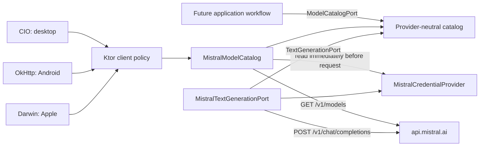

# Mistral provider boundary

Model discovery and streaming chat are isolated from presentation and application policy by
core-owned ports.

`core:domain` owns the stable vocabulary: model identifiers, aliases, optional context windows,
availability, understood capabilities, ordered generation events, retry advice, and safe failure
categories. `adapters:mistral` owns the wire DTOs and maps them at the boundary. Provider JSON and
Ktor types do not escape the adapter. Streaming details are documented in the
[streaming chat guide](mistral-streaming-chat.md).

## Conservative mapping

Every understood capability is tri-state. Provider `true` maps to `SUPPORTED`, `false` maps to
`UNSUPPORTED`, and an omitted value maps to `UNKNOWN`. Availability follows the same rule for the
provider's `archived` field. Consumers must therefore receive explicit evidence before enabling a
capability.

Catalog entries are returned in stable identifier order. A malformed entry rejects the entire
snapshot rather than returning a partly trustworthy catalog. Unknown JSON fields are ignored,
allowing compatible additions to the upstream response.

## Request and credential policy

- The production URL is a constant, HTTPS-only Mistral endpoint; it is not configuration input.
- Redirect following is disabled. Any 3xx response becomes `REDIRECT_REJECTED`.
- The bearer value is requested just in time and added only to the catalog request.
- Unsafe credential strings fail before the HTTP engine is called.
- Connect, socket, and request timeouts are finite; coroutine cancellation is always propagated.
- Adapter ownership is explicit: callers close `MistralModelCatalog` to release its HTTP resources.

## Failure boundary

| Provider or transport outcome | Domain category |
| --- | --- |
| Missing or unsafe credential | `CREDENTIAL_UNAVAILABLE` |
| `401`, `403`, `402`, `404` | Corresponding typed category |
| `429` | `RATE_LIMITED` |
| Redirect | `REDIRECT_REJECTED` |
| `408`, `5xx`, timeout, network I/O | `UNAVAILABLE` |
| Malformed success payload | `INVALID_RESPONSE` |
| Other safely caught failure | `UNEXPECTED` |

Provider error bodies never cross the boundary. A numeric `Retry-After` is retained only when it is
between zero and 24 hours; other values are discarded.

## Verification strategy

Synthetic protocol tests use Ktor's mock engine and no real credential. They verify the exact host,
path, method, media type, and authorization scheme; exercise documented failures and forward-
compatible JSON; and prove that a redirect does not cause a second request or forward a bearer
credential. Desktop and Android run these contract tests, while CI also compiles the Apple adapter
and runs the simulator test suite.
