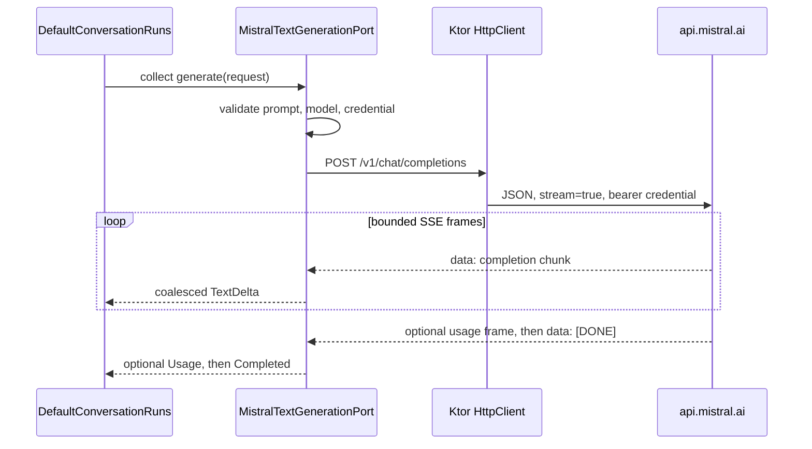
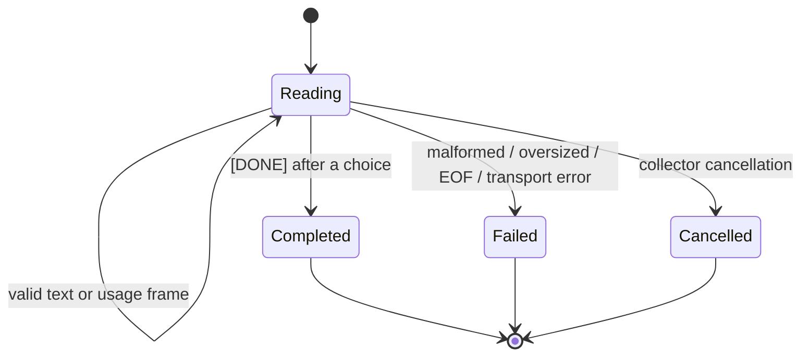

# Mistral streaming chat

The streaming adapter is a cold, single-attempt implementation of the core-owned
`TextGenerationPort`.

Cancelling collection cancels the request. The adapter does not create a background scope, reconnect
an SSE session, or replay the POST. A bounded `channelFlow` bridges platform HTTP callback contexts
without breaking structured concurrency.

## Wire scope

The request contains only:

- the validated model identifier;
- one `user` message containing the validated core prompt;
- explicit streaming mode; and
- optional maximum-output-token and temperature values snapshotted by the application.

Optional generation controls are omitted when the user selects model defaults. Temperature is
limited to the provider's documented recommended 0.0–0.7 range; `top_p` is intentionally not
exposed alongside it.

Run and conversation identifiers are local lifecycle data and are deliberately absent. The adapter
accepts response content as a string or as an array containing only `{ "type": "text" }` chunks.
Other content types require a separate domain design rather than silent data loss.

## Stream state

Text after a provider finish reason is invalid. Data after `[DONE]` is never consumed. An empty
stream or end-of-input without `[DONE]` cannot become a successful run.

## Resource limits

| Boundary | Limit | Failure behavior |
| --- | ---: | --- |
| Prompt | 131,072 characters | Reject before credential access or network I/O |
| SSE line | 131,072 decoded characters | `INVALID_RESPONSE` |
| SSE event | 262,144 decoded characters | `INVALID_RESPONSE` |
| Generated text | 1,000,000 characters | Flush accepted text, then `INVALID_RESPONSE` |
| Delta batch | Flush from 128 characters | Reduces presentation update pressure |
| Inactivity | 30 seconds | `UNAVAILABLE` with explicit-new-attempt advice |

The overall request timeout is disabled only for this streaming call; connect policy remains shared
with the model-catalog client and the socket inactivity timeout remains finite.

## Failure and retry policy

| Outcome | Failure kind | Advice |
| --- | --- | --- |
| Missing or unsafe credential | `CREDENTIAL_UNAVAILABLE` | `DO_NOT_RETRY` |
| `401` or `403` | `UNAUTHORIZED` | `DO_NOT_RETRY` |
| `429` with bounded numeric delay | `RATE_LIMITED` | `RETRY_AFTER_DELAY` |
| `429` without usable delay | `RATE_LIMITED` | `EXPLICIT_NEW_ATTEMPT` |
| `408`, `5xx`, timeout, network I/O, unexpected EOF | `UNAVAILABLE` | `EXPLICIT_NEW_ATTEMPT` |
| Malformed or unsupported successful stream | `INVALID_RESPONSE` | `EXPLICIT_NEW_ATTEMPT` |
| Unclassified internal failure | `UNEXPECTED` | `DO_NOT_RETRY` |

An explicit new attempt always receives a new run identity from the application. The adapter makes
one network request per collection and never performs an automatic retry.

## Usage boundary

Streaming requests set `stream_options.include_usage` explicitly. The adapter maps only
non-negative `prompt_tokens`, `completion_tokens`, and `total_tokens` counts into the
provider-neutral `TokenUsage` model. The fields remain individually optional because a provider
frame may report only part of the aggregate. An absent usage frame stays `null`; it is never
represented as zero.

Usage-only frames do not complete a run. The adapter validates and merges compatible usage frames,
then emits one typed `GenerationEvent.Usage` immediately before successful completion. Conflicting
counts make the successful stream invalid. Raw usage JSON and unknown provider fields never enter
the core inspection contract.

## Verification

Offline tests use Ktor's mock engine and synthetic credentials. They cover the exact request body and
headers, split UTF-8 input, CRLF and multi-line SSE data, requested/partial/missing usage, string and
text-array content, generation-control mapping and omission, coalescing, all terminal paths,
partial-output preservation, bounds, status classification, redirect rejection, redaction,
single-request behavior, and cancellation of an in-flight request. No live provider request is
part of CI.
