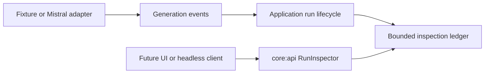

# Run inspection

Blowhard exposes operational run metadata through the provider-neutral `RunInspector` contract.
This first increment is intentionally process-local and headless: it establishes the safe data
model and collection policy before a shared inspector screen or file export can consume it.

## Allowlisted metadata

Each `RunInspection` contains only:

- opaque run and conversation identities;
- demo or live routing and the selected live model identifier;
- the accepted maximum-output and temperature controls;
- accepted, provider-started, and terminal timestamps;
- succeeded, failed, or cancelled terminal status;
- safe failure category, retry advice, and a bounded retry delay;
- optional provider-reported input, output, and total token counts.

The model has no field for prompts, generated output, credential values, authorization headers,
provider response bodies, or failure references. This is omission by construction, not a regex
redaction pass. Adapter failure references may remain available to the run lifecycle where already
classified as safe, but the inspector deliberately excludes them.

## Bounds and semantics

`RunInspection.MAX_EVENTS` caps one inspection at 32 chronological events. The current text
generation lifecycle emits at most three: accepted, started, and finished. Text deltas update the
conversation snapshot but never create inspection events, so a long token stream does not grow the
timeline. Usage updates replace one optional aggregate rather than appending events.

`TokenUsage` requires at least one non-negative reported count. Each count is nullable, and the
entire aggregate is nullable. Missing provider data therefore remains unknown rather than becoming
an invented zero. Usage does not determine success; it is attached only when the adapter reports a
valid aggregate before completion.

Inspection is passive. Looking up a run cannot start, repeat, cancel, or contact a provider. An
unknown or locally deleted run returns `NotFound`. Terminal inspection is updated alongside the
same immutable terminal transition observed by run clients.

## Current limitations

- Inspections exist only for runs owned by the current process and are not yet restored from
  SQLite.
- No shared inspector screen or diagnostic file export is included in this increment.
- Provider-reported counts are not independently recalculated and are not billing evidence.
- Tool, document, and approval events will extend the bounded model in later milestones.

These limitations keep the safe diagnostic contract independently reviewable before persistence,
presentation, and explicit user-selected export are added.
