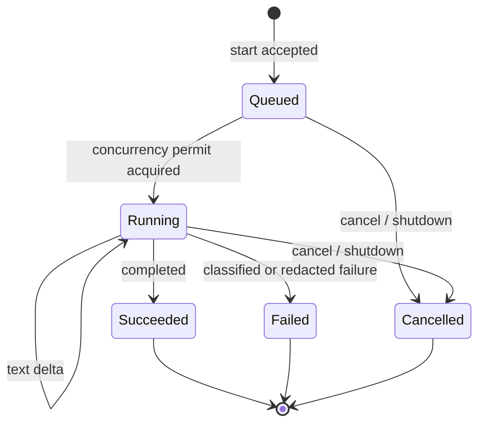

# Run lifecycle

The shared application service is the sole owner of generation work. `start` may create work;
`observe` and Flow collection are passive. Each accepted start receives a distinct attempt ID even
when it belongs to a previous conversation.



Terminal snapshots are immutable. Completion stops collection immediately, so a misbehaving fixture
or future adapter cannot append a late chunk. Cancelling an observer has no effect on execution;
clients use `ConversationRuns.cancel` explicitly.

Regeneration does not reopen or recollect a terminal run. It is an explicit client action that
submits the prior prompt through `start` and receives a fresh attempt ID. Both attempts remain
independently observable, and the provider adapter still executes at most once for each accepted
run. See [`ADR 0015`](../decisions/0015-explicit-regeneration-attempts.md).

## Headless fixture example

The fixture adapter runs through the production lifecycle boundary and requires neither a key nor a
network connection:

```kotlin
val provider = FixtureTextGenerationPort {
    FixtureScenario.Success(listOf("Hello", " from the offline fixture."))
}
val runs = DefaultConversationRuns(
    generation = provider,
    idFactory = SequentialRunIdFactory(),
    clock = SystemRunClock,
    coroutineContext = Dispatchers.Default,
)

val started = runs.start(StartRunRequest(ConversationId("demo"), "Say hello"))
val runId = (started as StartRunResult.Started).runId
val snapshots = (runs.observe(runId) as ObserveRunResult.Found).snapshots
val terminal = snapshots.first { it is RunSnapshot.Succeeded }

runs.close()
```

The repository retains snapshots only for the current application process. Durable history and
restart recovery are separate, later increments.
